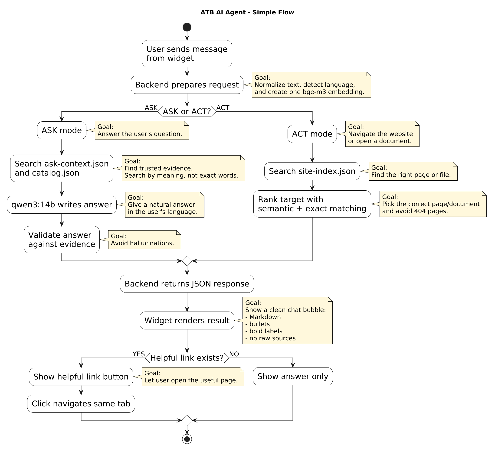

# Generic Website AI Agent

A local MVP / proof of concept for a website AI agent that can answer questions about a target website and help users navigate it.

The current demo target is the ATB public website, but the architecture is designed to be reusable for any website that can be indexed into context files.

## What the agent does

The agent supports two main modes:

### ASK mode

ASK mode answers questions about the target website.

It uses:

- normalized user queries
- one shared `bge-m3` embedding per request
- semantic retrieval over website context
- optional catalog/resource evidence
- `qwen3:14b` answer synthesis
- evidence-based guardrails to reduce hallucinations

Runtime context:

```text
site-context/<domain>/ask-context.json
```

Current demo file:

```text
site-context/atb.tn/ask-context.json
```

### ACT mode

ACT mode helps the user navigate the website.

It can find and open:

- pages
- documents
- public resources
- useful website targets

It uses semantic navigation over the generated site index, plus hybrid ranking with exact matching, document matching, and dead-page / 404 filtering.

Runtime index:

```text
site-context/<domain>/site-index.json
```

Current demo file:

```text
site-context/atb.tn/site-index.json
```


## Simple flow diagram


## High-level architecture

```text
User
  ?
Widget frontend
  ?
Node.js backend
  ?
Request preparation
  - normalize text
  - detect language
  - create one bge-m3 embedding
  ?
ASK or ACT routing

ASK:
  semantic retrieval over ask-context/catalog
  ?
  qwen3:14b synthesis
  ?
  grounded Markdown answer

ACT:
  semantic navigation over site-index
  ?
  hybrid ranking
  ?
  open page/document/navigation target
```

## Main stack

- Node.js / Express backend
- React / Vite widget frontend
- Chrome extension demo injector
- Ollama local models
- `qwen3:14b` for answer generation
- `bge-m3` for embeddings / semantic search
- Playwright-based capture/export tooling
- Generated website context and navigation JSON files

## Repository structure

```text
backend-node/
  Node.js backend, ASK/ACT routes, semantic services, resource/catalog logic

widget-agent/
  React widget frontend and production widget loader

widget-injector-extension/
  Chrome extension used to inject the widget into a live website for demo purposes

scripts/
  Website indexing, context generation, Playwright capture, and dev helper scripts

site-context/
  Generated runtime context files for indexed websites

docs/
  Architecture notes and diagrams
```

## Deployment methods

### 1. Demo method: Chrome extension

The Chrome extension is used when we do not control the target website source code.

It injects the widget into the website for demonstration.

```text
User opens target website
  ?
Chrome extension injects widget
  ?
Widget talks to local/backend API
```

This is useful for internship demos and prototypes.

Customers should not need to install the extension in production.

### Packaged Chrome extension

Run `npm run build:extension`, then load `widget-injector-extension` with **Load unpacked** in `chrome://extensions` (Developer mode). Reload the extension and refresh existing ATB tabs after updating it.

The React frontend, styles, and logo are packaged in `dist/widget.js`. An isolated content script mounts the assistant in Shadow DOM on `atb.tn` and `www.atb.tn`. ATB's CSP is unchanged; no iframe, page script, remote frontend, or header modification is used. UI edits require rebuilding the extension.

The extension prefers a healthy local backend on port 5000, so local demos do not need a Cloudflare tunnel. For remote demos, `widget-config.js` contains a fallback origin and the service worker also reads the local launcher's `/dev/widget-config`. Reload the extension after changing backend or tunnel URLs. API requests use the worker's restricted host permissions and route allowlist. The current Node backend must be running to use ASK/ACT.

ACT reads the live tab DOM and executes validated page plans in the content script. Indexed navigation and document actions return extension plans without requiring CDP. Conversations and navigation state are stored per tab in extension session storage.

`npm --prefix widget-agent run dev` provides a standalone UI preview. The old remote embed loader has been removed.

Validation: `node scripts/tests/extension-flow.test.cjs` runs Chromium with the unpacked extension and a local mock API on port 5000. Set `ATB_LIVE_TEST=1` to additionally check rendering on the live ATB website. Stop the local API first so the test can bind that port.

## Local setup

### 1. Install dependencies

From the repo root:

```powershell
npm install
npm --prefix backend-node install
npm --prefix widget-agent install
```

### 2. Install Ollama models

Make sure Ollama is installed and running.

```powershell
ollama pull qwen3:14b
ollama pull bge-m3
```

### 3. Configure backend environment

Copy the example env file:

```powershell
copy backend-node\.env.example backend-node\.env
```

Important values:

```env
ASK_USE_SEMANTIC_RETRIEVAL=true
ASK_USE_LLM_SYNTHESIS=true
ASK_SYNTHESIS_MODEL=qwen3:14b
ASK_EMBEDDING_MODEL=bge-m3

REQUEST_PREPARE_EMBEDDING=true
ACT_USE_SEMANTIC_NAVIGATION=true
ACT_EMBEDDING_MODEL=bge-m3
```

For the current demo catalog/resources:

```env
RESOURCE_ROOT_DIR=C:/laragon/www/atb-general-resources
RESOURCE_CATALOG_PATH=C:/laragon/www/atb-general-resources/catalog.json
RESOURCE_BASE_URL=http://localhost/atb-general-resources
```

These values are local-only and should stay in `backend-node/.env`, not in GitHub.

### 4. Start the app

```powershell
npm run dev
```

Expected local services:

```text
Backend API:     http://localhost:5000
Widget frontend: http://localhost:5174
Ollama:          http://localhost:11434
```

## Main scripts

See:

```text
scripts/README.md
```

Most important scripts:

```text
scripts/build-site-context.js
scripts/build-site-index.js
scripts/export-playwright-capture.js
```

They generate or support the website context and navigation data used by ASK mode and ACT mode.

## Runtime context files

The important committed runtime files for the current demo are:

```text
site-context/atb.tn/ask-context.json
site-context/atb.tn/site-index.json
```

They are committed so the agent can work after cloning the repository.

Generated screenshots, Playwright captures, semantic caches, logs, temporary files, and local `.env` files should not be committed.

## Validation commands

Focused backend checks:

```powershell
node backend-node/tests/askContext.test.js
node backend-node/tests/catalogRetrieval.test.js
node backend-node/tests/requestPreparation.test.js
npm --prefix backend-node run test:browser-routing
```

Widget build:

```powershell
npm --prefix widget-agent run build
```

## Current status

The main branch contains the final semantic ASK/ACT widget-agent implementation.

The current demo target is ATB, but the intended architecture is a reusable website agent pipeline:

```text
crawl/capture website
  ?
generate ask-context.json and site-index.json
  ?
run semantic ASK/ACT backend
  ?
serve widget frontend
  ?
inject with extension for demo or script tag for production
```

