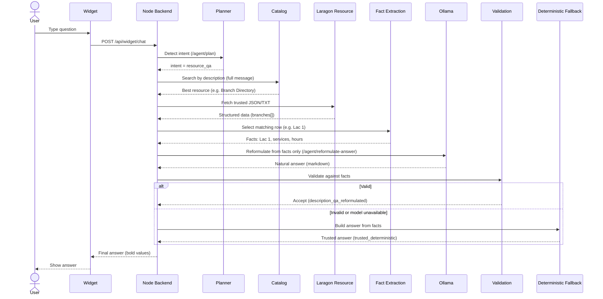

# ATB AI Banking Agent — Request-to-Response Architecture

This document explains how the ATB AI Banking Agent turns a user message into a final
answer. It is written for a general technical reader (a supervisor or reviewer) and reflects
the behaviour that is actually implemented in the code today.

---

## 1. Overview

The ATB AI Banking Agent is a banking assistant. A customer types a question in a chat
**widget**, and the system answers using trusted banking resources rather than guessing.

It is made of five cooperating parts:

- **Frontend / widget** — a React chat UI the user talks to.
- **Node.js backend** — the orchestrator. Receives the request, decides what to do, controls
  retrieval and validation, and returns the final answer.
- **Python AI service** — a small service that talks to the local language model.
- **Ollama** — a locally hosted language model (no external cloud call).
- **Laragon resources** — trusted banking files (JSON / TXT / PDF / images) served locally and
  described in a catalog.

The key idea: **the language model helps with language, but the backend controls the facts.**

---

## 2. High-level architecture

| Component | Responsibility | Main files |
|---|---|---|
| User interface / widget | Sends the user message, shows the answer | (frontend) |
| Node.js backend (Express) | Routing, retrieval, validation, final answer | `backend-node/src/app.js`, `backend-node/src/controllers/chat.controller.js` |
| Widget route | Exposes `POST /api/widget/chat` | `backend-node/src/routes/widgetDemo.routes.js` |
| Planner / router | Detects the user's intention and the request type | `backend-node/src/services/intentPlanner.service.js` |
| Resource catalog | Finds the best matching resource by description | `backend-node/src/services/resourceCatalog.service.js` |
| Laragon trusted resources | The real banking data (JSON/TXT/PDF/images) | local resource server + catalog |
| Python AI service | Bridge to the model (plan / decide / reformulate) | `ai-service-python/app/main.py` |
| Ollama model calls | Prompt building + JSON parsing for the model | `ai-service-python/app/services/ollama_service.py`, `ai-service-python/app/services/description_qa_service.py` |
| Deterministic answer builders | Build exact answers from trusted data | `backend-node/src/services/resourceAnswer.service.js` |
| Validation & fallback layer | Accept/reject model answers, fall back safely | `backend-node/src/controllers/chat.controller.js` |
| Backend ↔ AI client | HTTP calls from Node to the Python service | `backend-node/src/services/aiClient.service.js` |

The Python AI service exposes these endpoints (see `ai-service-python/app/main.py`):
`/agent/plan`, `/agent/decide`, `/agent/analyze`, `/agent/rerank-resources`,
`/agent/answer-from-descriptions`, `/agent/reformulate-answer`, `/agent/analyze-vision-document`.

---

## 3. Request-to-response flow

Step by step, for a normal question:

1. The user sends a message in the **widget**.
2. The widget sends `POST /api/widget/chat` with the message.
3. Express routes it (`backend-node/src/app.js` mounts `/api/widget`) to **`handleChatMessage`**
   in `backend-node/src/controllers/chat.controller.js` (route defined in
   `widgetDemo.routes.js`).
4. The backend opens a **route trace** and logs the request (one summary line in normal mode;
   see Section 8).
5. The **planner** (`intentPlanner.service.js`, backed by `/agent/plan`) detects the user's
   intention.
6. The **router** decides the request type: resource question, document retrieval, image
   analysis, banking action, or a normal informational answer.
7. For a **resource question**, the backend searches the **catalog** using
   **description-only matching** (`resourceCatalog.service.js`).
8. The backend **selects the best resource candidate**.
9. For structured resources, the backend **fetches the trusted JSON/TXT file from Laragon**.
10. The backend **extracts only the exact relevant facts** (for the Branch Directory, this is a
    single branch row).
11. **Ollama reformulates** the answer **from the extracted facts only**
    (`/agent/reformulate-answer`).
12. The backend **validates** the model's answer.
13. If validation fails, a **deterministic builder** returns the trusted answer instead.
14. The **final response** is sent back to the widget.

---

## 4. Resource QA architecture (the important part)

Older versions let the model read a long, multi-row catalog description and answer freely. That
caused mistakes — for example mixing one branch's services into another branch's answer. The
current architecture removes that risk:

1. **Catalog descriptions are used only for retrieval** — to find the right resource
   (`resourceCatalog.service.js`, `selectionPolicy.matchFields = ["description"]`).
2. **The model does not answer from the whole description.** Instead, the backend first
   **extracts the exact facts** needed (`extractBranchFacts` in `resourceAnswer.service.js`).
3. **Ollama only reformulates** those extracted facts into a natural sentence
   (`reformulate_answer_from_facts` in `ollama_service.py`). It never sees the other rows.
4. **Validation** checks the answer is supported by the facts, short, **bold**, and does not
   reference any other branch (`validateReformulatedAnswer` in `chat.controller.js`).
5. **Deterministic builders** are the reliable fallback (`buildBranchAnswerFromFacts` /
   `buildBranchDirectoryAnswer` in `resourceAnswer.service.js`).

### Branch Directory example

> **User:** "What services are available at Lac 1?"

- The catalog selects the **Branch Directory** resource (by description).
- The backend fetches the branch **JSON** from Laragon.
- Extraction selects **only the Lac 1 row**.
- Extracted facts: `Lac 1`, `Premium desk`, `SME support`, `09:00-17:00`.
- Ollama reformulates **from those facts only**, then the answer is validated.
- **Final answer:**
  > The **Lac 1** branch provides **Premium desk** and **SME support**.

If the model's wording is rejected (or the model is unavailable), the deterministic builder
returns the same correct, bolded answer.

---

## 5. Why this architecture is reliable

- The **LLM** is used for what it is good at: understanding the question and producing natural
  wording.
- The **backend** controls retrieval, fact extraction, validation, and safety.
- The model **cannot invent** unsupported banking facts — every important (bold) value in the
  answer must come from the extracted facts, or the answer is rejected.
- If the model fails, is wrong, or is unreachable, the **deterministic builder still returns the
  correct answer** from trusted data.
- This directly prevents real bugs we saw before, such as **mixing Tunis Centre services into a
  Lac 1 answer**, or answering with the nearest/default branch instead of the branch that
  actually offers the requested service.

---

## 6. Routing modes

The router (planner modes in `intentPlanner.service.js`) classifies each request:

- **`resource_qa`** — answer a question from catalog/resources (the main path).
- **`resource_document`** — show/download a document, only when explicitly requested.
- **`image_analysis`** — read an image via OCR / vision (when the user asks to read an image).
- **`banking_action`** — sensitive actions such as payments or transfers (these require
  preparation/confirmation, not a free answer).
- **`informational_answer`** — general banking support answers.

Document retrieval is only chosen for **explicit retrieval wording** (show, open, view, download,
plus a document noun like PDF / document / file / image). A fact question such as
"what services are available at Lac 1?" deliberately **stays in `resource_qa`** — the backend
demotes a mislabeled `document_show` back to `resource_qa` when there is no explicit file request
(`buildPlannerRouterDecision` in `intentPlanner.service.js`).

---

## 7. Fallback strategy

The backend tries the most controlled option first and always has a safe last resort:

1. **Extract facts + Ollama reformulation** — natural wording, constrained to extracted facts.
2. **Validation** — accept only if supported, short, bolded, single-row.
3. **Deterministic builder** — exact answer built from the extracted trusted facts.
4. **Trusted JSON/TXT fallback** — answer from the parsed trusted file fields.
5. **Writer (model) as last resort** — only for non-specific resources where no deterministic
   builder applies.

Because step 3/4 are always available for structured resources, a wrong or missing model output
never produces a wrong banking fact — it produces the trusted answer.

---

## 8. Debugging and observability

The system has built-in, env-controlled observability (in `routeTrace.service.js`):

- **`[ROUTE_TRACE]`** lines log each important stage (router decision, catalog search, candidates,
  selected file, trusted fetch, parse, extraction, validation, final response). Shown only in
  **verbose** mode.
- **`[ANSWER_PROOF]`** shows which source produced the answer (deterministic vs writer) and key
  facts (selected resource, matched branch/service, bold status). Verbose mode.
- **`[REQUEST_SUMMARY]`** prints **one clean line per request** in normal (summary) mode.
- **`data.debugTrace`** (in the API response, only when `DEBUG_AGENT_ROUTING=true`) can show the
  route, catalog candidates, selected file, extracted facts, validation result, final source, and
  bold status.
- **`debugBuild`** and the **`X-ATB-Debug-Build`** response header prove which backend build is
  actually running.

Logging is controlled by two environment variables:

```env
DEBUG_AGENT_ROUTING=false      # true also attaches data.debugTrace to the response
REQUEST_LOG_MODE=summary       # off | summary | verbose
```

- `off` — no per-request logs.
- `summary` — one `[REQUEST_SUMMARY]` line per request (recommended for demos).
- `verbose` — full `[ROUTE_TRACE]` stages (requires `DEBUG_AGENT_ROUTING=true`).

Service/startup links (web, widget, backend, AI service, internal health URLs) are always shown,
independent of these modes.

---

## 9. Example traces / expected behavior

For Branch Directory questions, the expected final answers and final sources:

| User question | Expected answer | Final source |
|---|---|---|
| "Which branch has SME support and what are its hours?" | The **Lac 1** branch provides **SME support** and is open from **09:00 to 17:00**. | `description_qa_reformulated` or `trusted_deterministic` |
| "Where can I get premium desk service?" | The **Lac 1** branch provides **Premium desk** service and is open from **09:00 to 17:00**. | `description_qa_reformulated` or `trusted_deterministic` |
| "What services are available at Lac 1?" | The **Lac 1** branch provides **Premium desk** and **SME support**. | `description_qa_reformulated` or `trusted_deterministic` |
| "What services does Ariana provide?" | The **Ariana** branch provides **Accounts**, **ATM**, and **transfers**. | `description_qa_reformulated` or `trusted_deterministic` |
| "Which branch handles deposits?" | The **Menzah 6** branch (the row that lists deposits). | `description_qa_reformulated` or `trusted_deterministic` |

In every case the answer comes from the single matching branch row. When the model wording passes
validation the source is `description_qa_reformulated`; otherwise the deterministic builder is used
and the source is `trusted_deterministic`. Both produce the same correct, bolded facts.

---

## 10. Sequence diagram



---

## 11. Summary (for reviewers)

The system combines **LLM flexibility with deterministic banking reliability**. The model
understands the question and reformulates the answer in natural language, but the **backend
controls what facts are allowed**, validates the model's output, and **falls back to trusted
structured data** when the model is wrong or unavailable. This design lets the assistant sound
natural while guaranteeing that the banking facts it reports are always taken from trusted
resources — never invented, and never mixed between records.
