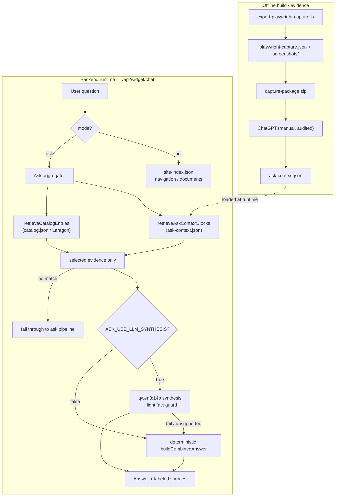

# ATB AI Agent — Final Demo Architecture

Frozen reference for the demo. Two agent modes (**Ask** = knowledge Q&A, **Act** =
navigation/documents), three runtime JSON files, one offline build/evidence
pipeline, and an optional local-LLM synthesis step that is safe by default.

---

## 1. Runtime files (loaded by the backend at request time)

| File | Role | Consumed by |
| --- | --- | --- |
| `site-context/<domain>/site-index.json` | **Act** mode: navigation / page & document logic (crawled inventory, forms, document links) | `siteIndex.service.js`, `siteIndexAgent.service.js` |
| `site-context/<domain>/ask-context.json` | **Ask** mode: public website Q&A context (dense `contextBlocks` with evidence) | `askContext.service.js` |
| `catalog.json` (Laragon, `RESOURCE_CATALOG_PATH`) | **Ask** mode: structured catalog / business data (products, checklists, branch data) | `resourceCatalog.service.js` → `catalogRetrieval.service.js` |

`context.json` is **obsolete/deleted** — not referenced at runtime.
The domain is derived generically from `TARGET_URL` (default `https://atb.tn`).

## 2. Build / evidence files (offline, NOT loaded at runtime)

Produced by the Playwright capture exporter under
`site-context/<domain>/playwright-capture/`:

| File | Purpose |
| --- | --- |
| `playwright-capture.json` | Manifest: per-page rendered text, headings, sections, links, forms, document links |
| `screenshots/` | One full-page PNG per captured URL (visual confirmation) |
| `capture-package.zip` | `playwright-capture.json` + `screenshots/`, ready to upload to ChatGPT (split into `capture-package-part-NNN.zip` when large) |

This package is **evidence only** — it is uploaded to ChatGPT to author
`ask-context.json`; the backend never reads it.

## 3. End-to-end flow

```
BUILD (offline, one-time per snapshot)
  export-playwright-capture.js  ──►  playwright-capture.json + screenshots/ + capture-package.zip
  capture-package.zip  ──►  ChatGPT (manual, audited)  ──►  ask-context.json

RUNTIME (per user question, mode = ask)
  question
    ├─ retrieveAskContextBlocks(q)   → top blocks from ask-context.json   (public site)
    ├─ retrieveCatalogEntries(q)     → top entries from catalog.json      (business data)
    ├─ combine selected evidence (sources stay separate)
    ├─ ASK_USE_LLM_SYNTHESIS=true ?
    │     ├─ send ONLY selected evidence to qwen3:14b  → validated natural answer
    │     └─ on fail/timeout/empty/unsupported-fact → deterministic buildCombinedAnswer
    │   else → deterministic buildCombinedAnswer
    └─ no ask-context AND no catalog match → answered:false → fall through to existing ask pipeline

RUNTIME (mode = act)  →  unchanged, driven by site-index.json
```

Guarantees:
- The model receives **only the selected blocks/entries**, never the full
  `ask-context.json` or `catalog.json`.
- Every answer carries labeled sources:
  `Source: ask-context.json — <page URL>` and
  `Source: catalog.json (id=…, category=…)`.
- A light guard rejects answers whose numbers / emails / phone numbers are not
  present in the selected evidence → deterministic fallback.
- Deterministic builder always protects the demo when Ollama is unavailable.

## 4. Environment flags (Ask-mode synthesis)

Add to `backend-node/.env` (see `.env.example`):

```env
# Off by default — deterministic grounded answers.
ASK_USE_LLM_SYNTHESIS=false
# Set true to enable qwen3:14b natural-language synthesis (auto-fallback on failure).
ASK_SYNTHESIS_MODEL=qwen3:14b
ASK_SYNTHESIS_TIMEOUT_MS=60000
# OLLAMA_BASE_URL=http://127.0.0.1:11434   # shared with other local-model calls
# RESOURCE_CATALOG_PATH=C:/laragon/www/atb-general-resources/catalog.json
```

`ASK_USE_LLM_SYNTHESIS=false` is the safe demo default: fully deterministic,
no model dependency.

## 5. Demo commands

Run from the repo root unless noted. Ports: backend `5000`, widget (Vite)
`5173/5174`, AI service `8000`.

```bash
# Backend (chat endpoint: POST http://localhost:5000/api/widget/chat)
npm run dev:backend

# Widget / frontend (optional — only if driving the UI)
npm run dev:widget

# AI service (optional — only needed by other AI endpoints, not by ask-context synthesis)
npm run dev:ai

# Playwright capture exporter (rebuild evidence package; read-only, no login)
CAPTURE_MAX_PAGES=40 node scripts/export-playwright-capture.js site-context/atb.tn/site-index.json   # 40-page test
CAPTURE_MAX_PAGES=0  node scripts/export-playwright-capture.js site-context/atb.tn/site-index.json   # full site

# Enable qwen3:14b synthesis for a run (else deterministic)
#   PowerShell:  $env:ASK_USE_LLM_SYNTHESIS="true"; npm run dev:backend
#   bash:        ASK_USE_LLM_SYNTHESIS=true npm run dev:backend
```

Test ask mode over HTTP (backend running):

```bash
curl -s http://localhost:5000/api/widget/chat \
  -H "Content-Type: application/json" \
  -d '{"mode":"ask","message":"what are the ATB exchange rates for foreign currency?"}'
```

Ask-mode unit checks (no server, no Ollama):

```bash
node backend-node/tests/askContext.test.js
node backend-node/tests/catalogRetrieval.test.js
```

## 6. Demo questions

| # | Type | Question | Expected |
| --- | --- | --- | --- |
| 1 | ask-context only | `what are the ATB exchange rates for foreign currency?` | Answer from `ask-context.json` (devise page) — currencies, last-update timestamp. `Source: ask-context.json — https://atb.tn/devise …` |
| 2 | catalog only | `what documents are needed for an SME business account?` | Answer from `catalog.json` (SME checklist). `Source: catalog.json (id=…, category=…)` |
| 3 | mixed | `ATB business current account and where to find accounts` | Blends accounts page (ask-context) + SME entry (catalog), both sources labeled |
| 4 | unrelated | `lattice gauge quantum chromodynamics` | `I don’t have enough information in the captured site context or catalog to answer that.` (fall-through / not-enough-info) |
| 5 | act / navigation | `download the account opening form` (mode `act`) | Act mode uses `site-index.json` to locate/navigate the document — unchanged |

With `ASK_USE_LLM_SYNTHESIS=true`, questions 1–3 return a qwen3:14b natural
answer built only from the selected evidence (deterministic wording otherwise);
question 4 is unchanged; question 5 is Act mode and unaffected.

## 7. Known issue (pre-existing)

`backend-node/tests/agentCaseRouter.test.js` fails on a `resource_image_qa`
routing assertion. This is **pre-existing and unrelated** to the ask-context /
catalog / synthesis work — it fails on the same commit without these changes and
touches none of these files. Not fixed here by scope.

## 8. Architecture diagram


```
site-index.json  ─►  ACT  (navigation, documents)
ask-context.json ─►  ASK  (public website context)   ┐
catalog.json     ─►  ASK  (structured business data) ┘ ─► qwen3:14b (selected evidence only) ─► answer + sources
                                                          └► deterministic fallback (demo-safe)
```
