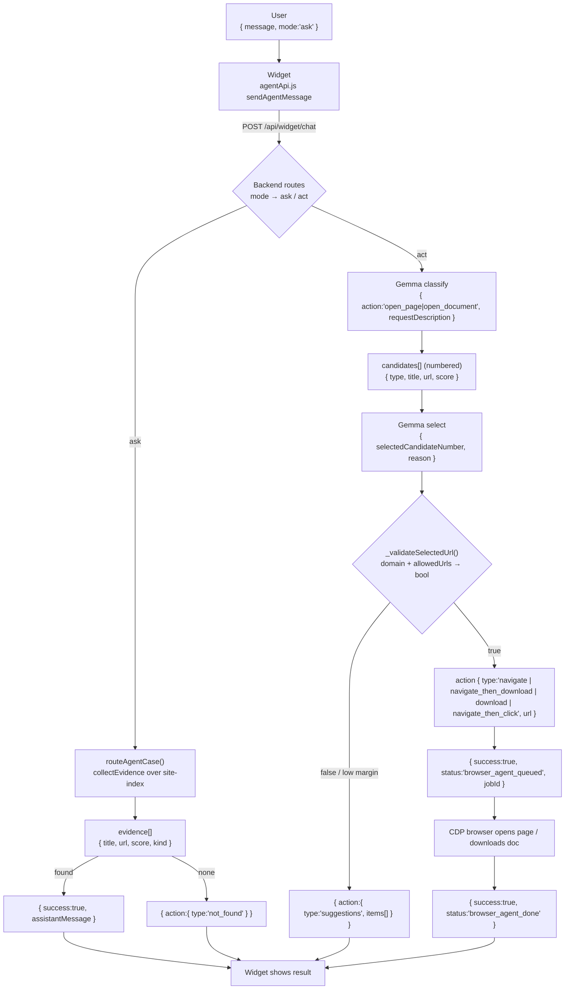

# Runtime JSON Verification — ATB AI Agent

Diagram reviewed: **"ATB AI Agent - Simple Flow with Minimal JSON"**
Verified against actual code. Nothing below is invented — every "actual code JSON" is quoted from a real file/function cited inline.

---

## 1. Executive summary

**Overall: the diagram is directionally correct but its JSON is mostly *conceptual*, not runtime-accurate.** The *flow* (User → Widget → Backend → branch ASK/ACT → site-index → Gemma classify → candidates → Gemma pick → validate → browser/answer → widget) matches what the code does. The *field names* in the diagram are simplified placeholders that do **not** match real variable names in ~8 of 14 steps.

- **Accurate as-is:** `not_found` and `suggestions` action types are real; Gemma's `open_page | open_document` is real.
- **Simplified but OK for a supervisor demo (say "conceptual"):** the ASK `sources` array, the `{valid:true}` validation, the `{do:...}` browser step, the `{ok:true}` final result. These represent real steps but no such literal JSON object exists.
- **Needs correcting before the demo (wrong field names that a technical supervisor will catch):**
  - `{pick:1}` → real field is `selectedCandidateNumber`.
  - candidate `{id, label}` → real fields are `{type, title, url, score}` (Gemma sees a numbered list, not `id`).
  - `{do:"open_page|open_document"}` → real action types are `navigate | navigate_then_download | download | navigate_then_click`.
  - `{ok:true}` → real field is `success`, plus a `status` string.
  - Widget request is far larger than `{message, mode}`.

Bottom line: **keep the diagram's shape, relabel the JSON to the real field names in section 3, and mark the 4 conceptual boxes as "conceptual" so you can defend them.**

---

## 2. Diagram JSON verification table

| # | Diagram step | Diagram JSON | Actual code JSON | Status | Notes / file |
|---|---|---|---|---|---|
| 1 | User sends message | `{message, mode:"ask\|act"}` | `{message, payload, conversationId, conversationHistory, profileContext, agentContext, pageSnapshot, pageGoalState, mode, cacheContext, siteContext}` | Partially correct | `message`+`mode` real; `mode` defaults `"ask"`. Many more fields. `widget-agent/src/services/agentApi.js:528-556` `sendAgentMessage` |
| 2 | Widget → backend | same as 1 | same as 1 (POST `/api/widget/chat`) | Partially correct | Same object as step 1 |
| 3 | Branch ASK/ACT | — | ASK: `agentCaseRouter.routeAgentCase()` `case` enum. ACT browser path: `siteIndexAgent.decideAction()` via `/api/widget/...` browser route | Conceptual (correct intent) | `agentCaseRouter.service.js:800`; `widgetDemo.routes.js:324` |
| 4 | ASK searches trusted knowledge | `{sources:["site-index","Laragon","current page"]}` | No such object. Evidence collected by `collectEvidence(query, index)` over the loaded site-index; Laragon catalog + page snapshot are separate mechanisms | **Conceptual only** | `siteIndex.service.js:745` `collectEvidence` |
| 5 | Collect matching evidence | `[{title, score:0.82}]` | `[{sourceType, kind, title, url, text, score}]` (collectEvidence) / `[{type, title, url, score}]` (topMatches) | Partially correct | `title`+`score` real; more fields exist. `siteIndex.service.js:745-813`; `siteIndexAgent.service.js:967` `_topMatches` |
| 6 | Info found → answer | `{type:"answer", text}` | `{success:true, assistantMessage:"...", ...}` | Partially correct / conceptual | No `type:"answer"`. Real key is `assistantMessage`. `widgetDemo.routes.js:354-359`; `chat.controller.js` `res.json` sites |
| 7 | Info not found | `{type:"not_found"}` | `action:{type:"not_found"}` | **Correct** | Real, as `action.type`. `siteIndexAgent.service.js:986` `_notFound` |
| 8 | Gemma understands request | `{action:"open_page\|open_document"}` | `{action:"open_document"\|"open_page", requestDescription:"..."}` | **Correct** (add field) | Diagram missing `requestDescription`. `siteIndexAgent.service.js:746-761` `GEMMA_SYSTEM` |
| 9 | Backend finds candidates | `[{id:1, label}]` | `[{type, title, url, score}]`, presented to Gemma as a **numbered** list | Partially correct | No `id`/`label`. Number = list position. `siteIndexAgent.service.js:967` `_topMatches` |
| 10 | Gemma chooses best | `{pick:1}` | `{selectedCandidateNumber:1, reason:"..."}` | Partially correct (rename) | `pick` → `selectedCandidateNumber`; `0` = no match. `siteIndexAgent.service.js:763-776` `GEMMA_SELECT_SYSTEM` |
| 11 | Backend validates choice | `{valid:true}` | boolean from `_validateSelectedUrl(finalUrl, domain, raw, idx)`; fail → returns `_notFound` object | **Incorrect as JSON** (conceptual) | It's a boolean gate, not a `{valid}` object. `siteIndexAgent.service.js:1148,1310-1316` |
| 12 | Browser opens page/doc | `{do:"open_page\|open_document"}` | `action:{type:"navigate"\|"navigate_then_download"\|"download"\|"navigate_then_click", url, ...}` → job `{success:true, status:"browser_agent_queued", jobId}` | **Incorrect** (rename) | No `do`. `siteIndexAgent.service.js:1012-1038`; `widgetDemo.routes.js:363-411` |
| 13 | Not valid → suggestions | `{type:"suggestions"}` | `action:{type:"suggestions", items:[...topMatches]}` | **Correct** (add field) | Diagram missing `items`. `siteIndexAgent.service.js:1336` |
| 14 | Widget shows result | `{ok:true}` | `{success:true, status:"browser_agent_done", ...}` (poll) or `{success:true, assistantMessage}` | Partially correct (rename) | `ok` → `success`. `widgetDemo.routes.js:559-572` |

---

## 3. Corrected minimal JSON flow

Smallest JSON per step, using **real** field names:

```
1. User → Widget
   { "message": "...", "mode": "ask" }              // mode defaults "ask"

2. Widget → Backend  (POST /api/widget/chat)
   { "message": "...", "mode": "ask" }              // + optional: conversationId, agentContext, pageSnapshot, ...

3. Branch: routeAgentCase() → case  |  decideAction() for browser ACT

── ASK ──
4. (conceptual) search site-index via collectEvidence()
5. [ { "title": "...", "url": "...", "score": 0.82, "kind": "page" } ]
6. { "success": true, "assistantMessage": "..." }
7. { "action": { "type": "not_found" } }

── ACT ──
8. Gemma classify:  { "action": "open_document", "requestDescription": "..." }
9. candidates:      [ { "type": "document", "title": "...", "url": "...", "score": 0.82 } ]   // numbered 1..N for Gemma
10. Gemma select:   { "selectedCandidateNumber": 1, "reason": "..." }
11. validate:       _validateSelectedUrl(url, domain, ...) → true|false   // boolean, not an object
12. browser action: { "type": "navigate_then_download", "url": "...", "sourceUrl": "...", "title": "..." }
    → queued:       { "success": true, "status": "browser_agent_queued", "jobId": "..." }
13. low margin →    { "action": { "type": "suggestions", "items": [ ... ] } }
14. widget poll →   { "success": true, "status": "browser_agent_done" }
```

---

## 4. Actual runtime request/response schemas

### Widget → backend request — `widget-agent/src/services/agentApi.js:528-556` (`sendAgentMessage`)
```json
{
  "message": "...",
  "mode": "ask",
  "conversationId": "optional",
  "conversationHistory": [],
  "agentContext": {},
  "pageSnapshot": {},
  "profileContext": {},
  "cacheContext": {},
  "siteContext": {},
  "payload": {},
  "pageGoalState": {}
}
```
All fields except `message` are optional; `mode` defaults `"ask"`.

### Backend → widget response — `chat.controller.js` / `widgetDemo.routes.js`
Widget reads defensively (`normalizeAgentResponse`, agentApi.js:449-482), so the canonical fields are:
```json
{ "success": true, "status": "optional", "assistantMessage": "...", "data": { "ai": {}, "quickActions": [] } }
```

### ASK mode internal — `siteIndex.service.js:745-813` (`collectEvidence`)
```json
{ "sourceType": "site-index", "kind": "page", "title": "...", "url": "...", "text": "...", "score": 0.82 }
```

### ACT mode internal — `siteIndexAgent.service.js:1040-1049` (`_buildResult`)
```json
{ "found": true, "confidence": 0.0, "resourceType": "document", "intent": "document", "action": {}, "answer": "...", "reason": "...", "topMatches": [] }
```

### Gemma / router output — `siteIndexAgent.service.js:746-776`
```json
// stage 1 (classify)
{ "action": "open_document", "requestDescription": "..." }
// stage 2 (select from numbered candidates)
{ "selectedCandidateNumber": 1, "reason": "..." }
```
Parsed by `parseIntent()` (:779) and `parseSelectNumber()` — both tolerate ```` ```json ```` fences and extract the first `{...}`.

### Candidate / page-document format — `siteIndexAgent.service.js:967` (`_topMatches`)
```json
{ "type": "document", "title": "...", "url": "...", "score": 0.82 }
```

### Validation result — `siteIndexAgent.service.js:1148` (`_validateSelectedUrl`)
Returns a **boolean** (not JSON). Same-hostname check + `allowedUrls` Set membership. Fail → `_notFound` object is returned instead of the result.

### Browser action objects — `siteIndexAgent.service.js:1012-1038`
```json
{ "type": "navigate", "url": "...", "title": "...", "highlightText": "" }
{ "type": "navigate_then_download", "sourceUrl": "...", "documentUrl": "...", "url": "...", "title": "...", "highlightText": "..." }
{ "type": "download", "url": "...", "title": "...", "highlightText": "..." }
{ "type": "navigate_then_click", "sourceUrl": "...", "url": "...", "linkText": "...", "highlightText": "...", "executionType": "click_visible_document_button" }
```

### Final widget result — `widgetDemo.routes.js`
```json
{ "success": true, "status": "browser_agent_queued", "jobId": "..." }   // :375,387,397,410
{ "success": true, "status": "browser_agent_done" }                     // :572 (poll)
{ "success": true, "status": "browser_agent_running" }                  // :553,561
{ "success": false, "status": "browser_agent_error", "message": "..." } // :550,566
{ "success": false, "status": "not_found" }                            // :548,559
```
Browser execution is **CDP-driven** (visible Chrome tab) via an async job + poll; if CDP is unreachable it degrades to a direct-link text answer (`checkCdpReachable`, widgetDemo.routes.js:350-360).

---

## 5. site-index.json schema

Confirmed by reading `site-context/atb.tn/site-index.json` (2678 pages). Top-level keys — **all 9 present, exactly as you listed**:

| Section | Purpose | Important fields | Minimal example |
|---|---|---|---|
| `meta` | Build provenance | `domain, targetUrl, sourceFile, rawGeneratedAt, generatedAt, status` | `{"domain":"atb.tn","status":"complete"}` |
| `rawStats` | Pre-clean crawl counts | `pagesCrawled, urlsDiscovered, documentsFound, documentActionsFound, formsFound, failedPages` | `{"pagesCrawled":2678,"documentsFound":582}` |
| `cleanStats` | Post-dedup counts | `uniqueDocumentsFound, uniqueDocumentActionsFound, uniqueFormsFound, uniqueBusinessFormsFound, ...` | `{"uniqueDocumentsFound":582}` |
| `pages` | Crawled pages (nav targets) | `url, path, title, description, headings, textPreview` | `{"url":"...","title":"...","description":"..."}` |
| `uniqueDocuments` | Dedup downloadable docs | `documentUrl, filename, linkText, occurrencesCount, sourcePages` | `{"documentUrl":"...","filename":"x.pdf","linkText":"..."}` |
| `uniqueDocumentActions` | Doc buttons w/o known file URL | `linkText, occurrencesCount, sourcePages` | `{"linkText":"Télécharger","sourcePages":[...]}` |
| `uniqueForms` | Dedup HTML forms | `action, method, fields, occurrencesCount, sourcePages` | `{"action":"...","method":"post","fields":[...]}` |
| `uniqueBusinessForms` | Business-relevant subset of forms | `action, method, fields, occurrencesCount, sourcePages` | same shape as `uniqueForms` |
| `failedUrls` | URLs that failed to crawl | array (empty in current build) | `[]` |

Built by `scripts/build-site-index.js`; cleaned/deduped by `scripts/lib/site-index-clean.js` (invoked via `scripts/clean-site-index.js`).

**Note on backend loading:** the backend requires `Array.isArray(pages)` and detects this clean schema via `Array.isArray(uniqueDocuments)` (`siteIndexAdapter.service.js:23`). It then **synthesizes** legacy `resources[]`/`documentOccurrences[]` arrays from these keys so older scorer code keeps working — those legacy fields are **not** in the generated file, they're runtime-only.

---

## 6. Corrections needed for your diagram

- **Step 1/2:** note the request has more than `{message, mode}` (list `conversationId`, `agentContext`, `pageSnapshot` as optional). `mode` defaults `"ask"`.
- **Step 4:** mark `{sources:[...]}` as **conceptual only** — no such object exists; ASK evidence comes from `collectEvidence()`.
- **Step 5:** rename `{title, score}` → add real fields `{title, url, score, kind}`.
- **Step 6:** replace `{type:"answer", text}` → `{success:true, assistantMessage:"..."}`.
- **Step 8:** add the missing `requestDescription` field to the Gemma classify JSON.
- **Step 9:** replace `{id, label}` → `{type, title, url, score}`; say "candidates are numbered for Gemma", drop `id`.
- **Step 10:** rename `pick` → **`selectedCandidateNumber`** (and note `0` = no match).
- **Step 11:** mark `{valid:true}` as **conceptual** — validation is a boolean function `_validateSelectedUrl`, not a JSON object.
- **Step 12:** replace `{do:...}` → real action `{type:"navigate|navigate_then_download|download|navigate_then_click", url,...}`, then `{success, status:"browser_agent_queued", jobId}`.
- **Step 13:** add `items` to `{type:"suggestions"}`.
- **Step 14:** rename `{ok:true}` → `{success:true, status:"browser_agent_done"}`.
- **Missing from diagram (exists in code):** the two-stage Gemma (classify **then** select), the `confidence`/`score` margin gate, CDP-reachability fallback to a direct link.

---

## 7. Supervisor-safe explanation (say this)

- **The request JSON** (`{message, mode}`) is what the user's widget sends. `mode` tells the backend whether the user wants an **answer** (ask) or an **action** (act).
- **site-index.json is the trusted knowledge base.** It's a crawl of the real ATB site (2678 pages, 582 documents, forms) built offline by `scripts/build-site-index.js`. The agent is **only allowed to answer from and navigate to URLs that exist in this file** — that's what keeps it grounded and prevents it from inventing links.
- **Where Gemma is used:** two places, both in `siteIndexAgent.service.js`. First it **classifies** the request into `open_page` or `open_document`. Then, after the backend builds a candidate list from the index, Gemma **picks the best candidate by number** (`selectedCandidateNumber`). Gemma never produces URLs — it only classifies and chooses, so it can't hallucinate a destination.
- **Where backend validation happens:** before any browser action, `_validateSelectedUrl()` checks the chosen URL is on the ATB domain and is in the index's allow-list. If it fails, the agent returns "not found" instead of navigating. That's the safety gate.
- **Why it's an AI agent, not just a chatbot:** a chatbot only replies with text. This system **classifies intent, retrieves grounded candidates, has an LLM choose among them, validates the choice, and then physically drives a real Chrome browser (via CDP) to open the page or download the document** — an observe → decide → validate → act loop. That closed loop over real actions is what makes it an agent.

---

## 8. Mermaid diagram (corrected field names)



---

### Files inspected
`widget-agent/src/services/agentApi.js`, `backend-node/src/routes/widgetDemo.routes.js`, `backend-node/src/routes/chat.routes.js`, `backend-node/src/controllers/chat.controller.js`, `backend-node/src/services/siteIndexAgent.service.js` (ACT resolver + both Gemma prompts + validation), `siteIndex.service.js`, `siteIndexAdapter.service.js`, `agentCaseRouter.service.js`, `scripts/build-site-index.js`, `scripts/lib/site-index-clean.js`, `scripts/clean-site-index.js`, and the generated `site-context/atb.tn/site-index.json`.
